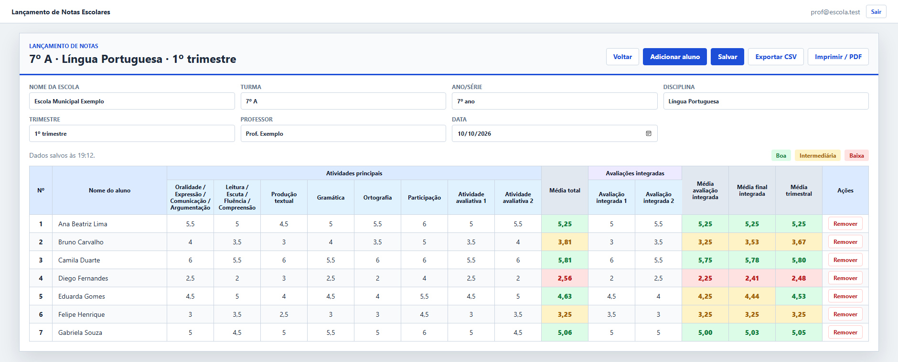

# Lançamento de Notas Escolares

[](https://github.com/KawanVictor/Notas-Escolares/actions/workflows/ci.yml)

Site para lançar as notas de uma turma, calcular as médias do trimestre e gerar a planilha em CSV ou PDF. Cada professor entra com a própria conta e acessa os seus lançamentos de qualquer computador ou celular.

**Endereço do site:** https://notas-escolares-iota.vercel.app



Os nomes e as notas da imagem são fictícios.

## Como usar

1. Abra o site e clique em **Criar conta**. A senha precisa ter pelo menos 8 caracteres. Confirme o cadastro pelo link enviado ao seu e-mail; antes disso o site não deixa entrar.
2. Clique em **Novo lançamento** e preencha os dados da turma (escola, turma, disciplina, trimestre, professor e data).
3. Clique em **Adicionar aluno** para cada aluno e digite o nome e as notas.
4. Clique em **Salvar** (ou `Ctrl+S`). Nada é gravado sozinho: o site avisa se você tentar sair com alterações não salvas. Enquanto houver algo pendente, o botão mostra **Salvar alterações**; depois de gravar, mostra **Salvo**.

Ao abrir um lançamento já salvo, os dados da turma ficam recolhidos em uma linha acima da tabela; clique em **Dados da turma** para editá-los. Os nomes das atividades aparecem abreviados no cabeçalho da tabela, e o nome completo aparece ao passar o mouse, na impressão e no CSV.

As notas vão de 0 a 6 e aceitam vírgula ou ponto (`4,5` ou `4.5`). `Enter` confirma a nota e desce para o próximo aluno; `Tab` vai para a próxima coluna.

| Botão | O que faz |
|---|---|
| Novo lançamento | Começa uma planilha em branco |
| Abrir / Excluir | Abre ou apaga um lançamento da sua lista |
| Adicionar aluno | Cria uma linha nova no fim da tabela |
| Salvar (`Ctrl+S`) | Grava o lançamento na sua conta |
| Exportar CSV | Baixa uma planilha que abre direto no Excel |
| Imprimir / PDF | Abre a impressão do navegador, que também salva em PDF |
| Voltar | Retorna à lista de lançamentos |

Use um lançamento por turma, disciplina e trimestre. Cada conta só enxerga os próprios lançamentos.

Se esquecer a senha, clique em **Esqueci minha senha** na tela de entrada para receber por e-mail um link que cria uma senha nova.

## Como as médias são calculadas

| Média | Cálculo |
|---|---|
| Média total | Média das 8 atividades principais |
| Média avaliação integrada | Média das 2 avaliações integradas |
| Média final integrada | Média entre a média total e a média da avaliação integrada |
| Média trimestral | Média entre a média total e a média final integrada |

Na prática, a média trimestral equivale a **75% da média total + 25% da média das avaliações integradas**.

Campos em branco são ignorados e não contam como zero. Para a nota entrar como zero, digite `0`.

As cores indicam a faixa da média:

| Faixa | Média |
|---|---|
| Boa (verde) | 4,5 ou mais |
| Intermediária (amarelo) | de 3,0 a 4,49 |
| Baixa (vermelho) | abaixo de 3,0 |

## Para quem mantém o sistema

O site é estático (HTML, CSS e JavaScript, sem etapa de build) e fica hospedado na Vercel. As contas e os dados ficam no Supabase.

| Caminho | Conteúdo |
|---|---|
| `public/` | O site publicado: `index.html`, `style.css` e a pasta `js/` |
| `public/js/app.js` | Telas: liga os botões e campos da página aos módulos abaixo |
| `public/js/conta.js` | Entrar, criar conta, recuperar senha e acompanhar a sessão |
| `public/js/dados.js` | Leitura, gravação e exclusão dos lançamentos no Supabase |
| `public/js/notas.js` | Regras: cálculo das médias e geração do CSV |
| `public/js/config.js` | Endereço e chave pública do projeto no Supabase |
| `supabase/migrations/` | Tabelas, regras de acesso e gatilho do banco |
| `tests/` | Testes automáticos |
| `scripts/servidor.js` | Servidor local usado pelo `npm run dev` |
| `.github/workflows/ci.yml` | Roda os testes no GitHub a cada envio |
| `vercel.json` | Cabeçalhos de segurança do site |
| `docs/` | Imagem usada neste README |

### Rodar no seu computador

É preciso ter o Node.js 20 ou mais novo. O projeto não tem dependências, então não há nada para instalar.

```
npm run dev
```

O site abre em `http://localhost:8123` e usa o mesmo banco do site publicado. Os links enviados por e-mail (confirmação de conta e senha nova) sempre levam ao site publicado, a menos que você inclua `http://localhost:8123` em **Authentication > URL Configuration > Redirect URLs** no Supabase.

### Testes

```
npm test
```

Os testes rodam só com o Node, sem instalar nada, e o GitHub os executa a cada envio para a `main` e a cada pull request.

| Arquivo | O que cobre |
|---|---|
| `tests/notas.test.js` | Cálculo das médias, faixas, datas e CSV, incluindo a proteção contra fórmulas |
| `tests/conta.test.js` | Entrar, criar conta, recuperar senha, mensagens de erro e as trocas de tela conforme a sessão |
| `tests/dados.test.js` | Gravação em três passos, falha em cada passo e nova tentativa, remoção de alunos e exclusão de lançamentos |

Os testes de conta e de dados usam um Supabase simulado (`tests/ajuda/supabase-falso.js`), então não tocam no banco real. O que eles não cobrem: a página em si (botões, tabela, diálogos) e as regras de acesso do banco, que precisam ser conferidas no navegador e no Supabase.

No CSV exportado, um nome ou campo que comece com `=`, `+`, `-` ou `@` recebe um apóstrofo na frente, para o Excel não executá-lo como fórmula.

### Publicação (Vercel)

O site está ligado ao repositório do GitHub: cada envio para a branch `main` é publicado sozinho em https://notas-escolares-iota.vercel.app. A Vercel publica apenas a pasta `public/`; o arquivo `.vercelignore` deixa o restante de fora.

Para publicar em outra conta da Vercel:

1. Importe o repositório em [vercel.com](https://vercel.com). Escolha o preset **Other** e deixe os comandos de build em branco.
2. No painel do Supabase, em **Authentication > URL Configuration**, coloque o endereço novo em **Site URL**. Sem isso, os links de confirmação de conta e de recuperação de senha apontam para o endereço errado.

### Banco de dados (Supabase)

O projeto se chama **Notas Escolares** e fica na região de São Paulo. As tabelas são `lancamentos` (dados da turma) e `alunos` (nome e notas).

A segurança vem das regras de acesso por linha (RLS): cada usuário só lê e altera os lançamentos de que é dono, e quem não entrou não acessa nada. Por isso a chave publicável pode ficar em `config.js`. A chave secreta (`service_role` ou `sb_secret_...`) nunca deve ir para o repositório.

O site grava um lançamento em três passos: dados da turma, alunos e, por último, a exclusão dos alunos removidos. Se a conexão cair no meio, o que está na tela não se perde e basta salvar de novo.

Para recriar o banco em outro projeto, execute os arquivos de `supabase/migrations/` no SQL Editor, na ordem dos nomes, e atualize `config.js` com o endereço e a chave publicável do projeto novo.

Pontos de atenção:

- **Plano gratuito:** o Supabase pausa projetos sem uso por cerca de uma semana. Basta reativar no painel; os dados continuam lá.
- **E-mails:** o envio de e-mails padrão do Supabase aceita poucas mensagens por hora. Para uma escola inteira, configure um servidor de e-mail próprio em **Authentication > Emails**.
- **Senhas vazadas:** a verificação de senhas já expostas em vazamentos está desligada no Supabase. Ela pode ser ligada em **Authentication**, nas configurações de senha, se o plano da conta permitir.
- **Dados de alunos:** o banco guarda nomes e notas de menores. Combine o uso com a escola e faça cópias de segurança.

### Mudar atividades, nota máxima ou faixas

As atividades, a nota máxima e os limites das faixas estão no início de `public/js/notas.js`. Uma atividade nova também precisa de uma coluna na tabela `alunos`.

## Licença

[MIT](LICENSE).
